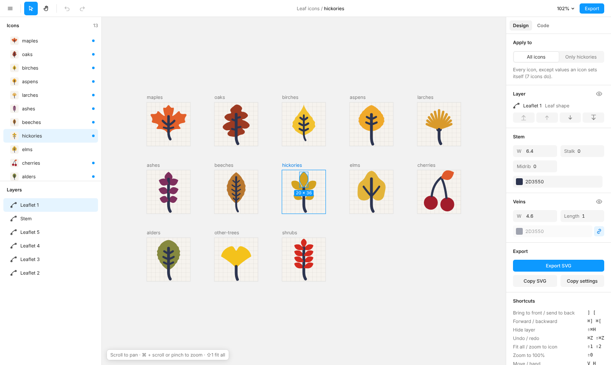

# Leaf icons

Thirteen tree-group leaf icons (maples, oaks, birches, …) on a 100×100 grid, and a small browser-based SVG editor for their stems, veins and layer order. The icons are drawn for [Canopy](https://github.com/maarib/canopy), a fall color map of Ontario.

**[Open the editor →](https://maarib.github.io/leaf-icons/)**



## The editor

It's laid out like Figma or Framer.

- **Icons and layers** (left). Pick an icon to zoom to it. Each leaf, leaflet, fruit, needle tuft, vein group and stem is a layer: drag rows to reorder them, or use the eye to hide one.
- **Canvas** (middle). Every icon is a frame on one canvas. Scroll to pan; ⌘ + scroll or pinch to zoom; hover to outline a shape and click to select it. Right-click a shape for the arrange menu.
- **Design** (right). Stem width, stalk length (how far it hangs below the leaf), midrib length (how far it runs up the leaf) and color; vein width, length and color. **All icons** changes the shared values; **Only \<icon\>** sets values for the current icon, shown in blue. Drag a field's label to scrub its value, or use ↑ / ↓ (Shift for ×10).
- **Code** (right). The current icon's SVG and the full settings file, ready to copy.
- **Export** downloads the current icon as an SVG.

| Shortcut | Does |
|---|---|
| `]` / `[` | Bring to front / send to back |
| `⌘]` / `⌘[` | Bring forward / send backward |
| `⇧⌘H` | Hide or show the selected layer |
| `⌘Z` / `⇧⌘Z` | Undo / redo |
| `⇧1` / `⇧2` / `⇧0` | Fit all / zoom to the current icon / zoom to 100% |
| `V` / `H`, or hold Space | Move / hand tool |
| `⇧G` | Layout grid (10 units) |

Edits are saved in your browser. To keep them in the repo, click **Copy settings**, paste into `stems.config.json`, and run the build.

## Build

```bash
npm run build
```

Node 22.18 or later, no dependencies. It writes `icons/<id>.svg` and `editor.html` from `src/shapes.ts` and `stems.config.json`. Commit both: CI checks they match a fresh build.

## Settings

`stems.config.json` holds the shared stem and vein settings and anything an icon sets for itself:

```json
{
  "stem":  { "width": 6.4, "color": "#2d3550", "length": 0, "midrib": 0 },
  "veins": { "show": true, "width": 4.6, "color": "#2d3550", "length": 1 },
  "icons": {
    "ashes": {
      "stem": { "midrib": -8.5 },
      "veins": { "length": 1.1 },
      "order": ["leaflet-2", "leaflet-5", "leaflet-6", "leaflet-1", "stem", "leaflet-7", "leaflet-4", "leaflet-3"],
      "hidden": ["leaflet-3"]
    }
  }
}
```

- `length` and `midrib` are in grid units, added to each icon's own stalk and midrib. Vein `length` scales each vein from where it leaves the midrib.
- `order` lists layer ids back to front. Layers it leaves out stay on top in their original order.
- `hidden` lists layers left out of the SVG. Veins are hidden with `veins.show` instead.

## How it's built

| File | What it is |
|---|---|
| `src/shapes.ts` | The leaf outlines, fall colors, and stems and veins as geometry (not finished paths), so their length can change |
| `src/render.js` | Draws one icon as SVG from its layers and the settings. The build and the editor both use it, so the editor shows exactly what the build writes |
| `scripts/build.ts` | Turns the shapes into named layers, writes the SVGs, and puts the editor together from `scripts/editor.template.html` |
| `icons/` | The built SVGs |

A stroke's width is `k × width` for its part, so strokes drawn thinner (maple's lower veins, the cherry stalks) keep their proportions. The cherry stalks join fixed points, so their width follows the stem setting but their length does not.

Each SVG uses classes and `data-layer`, so CSS can restyle it after the fact:

```html
<svg class="leaf leaf-maples" viewBox="0 0 100 100">
  <path class="blade" data-layer="leaf" fill="#e2602a" d="…"/>
  <g class="veins" data-layer="veins" stroke="#2d3550">…</g>
  <path class="stem" data-layer="stem" stroke="#2d3550" stroke-width="5.8" d="…"/>
</svg>
```

For example, `.leaf .stem { stroke: currentColor }` makes the stems follow the text color.

## Using the icons in Canopy

Canopy keeps its own copy in `src/lib/leafShapes.ts`: the same geometry, `LEAF_STYLE` (this repo's `stems.config.json`) and `LEAF_MARKS`, which draws like `src/render.js`. After changing the settings here, copy them into `LEAF_STYLE` there. `hidden` is not supported in Canopy yet.

## Deploying

`.github/workflows/pages.yml` builds on every push to `main` and publishes `editor.html` (as `index.html`), `icons/` and `stems.config.json` to GitHub Pages.
